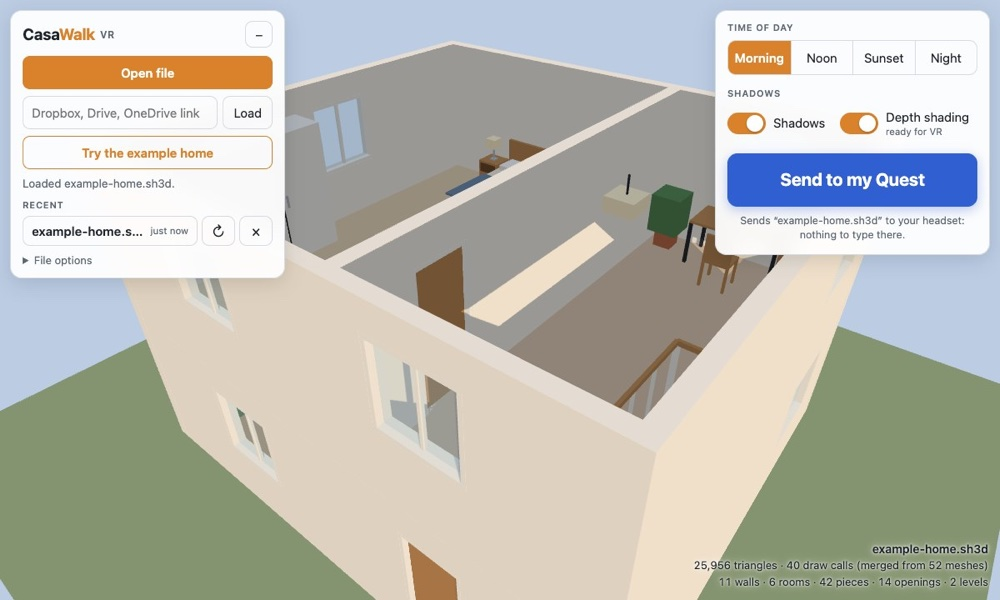

# CasaWalk VR

*Mi casa es tu casa.* Opens Sweet Home 3D files.

A WebXR viewer for [Sweet Home 3D](https://www.sweethome3d.com/) homes on Meta Quest. Open a `.sh3d` file directly (no export step), look at it as a scale model, then walk through it at real size. It also opens OBJ (plain, or zipped with MTL and textures) and GLB, including compressed GLB (Draco, meshopt).

**Try it: [casawalkvr.com](https://www.casawalkvr.com/)** (press *Try a sample home* if you have no file to hand).

It runs in the Meta Quest Browser: no app store, no developer mode, no sideloading. The same page works on a desktop browser as a 2D preview, so you can check a file before putting the headset on.

| On the page | Scale model, in the headset | Walking inside |
| --- | --- | --- |
|  |  |  |

(Pictures: the example home that ships with the project. The headset views are from an emulated Quest 2.)

> Status: all planned work is done (see [SPEC.md](SPEC.md)): 2D preview, the scale model in VR and passthrough, walking at 1:1, time of day, shadows and depth shading, a safety audit, and offline use. Tested on a real Quest 2 only.

## Using it

1. Open the app's URL (GitHub Pages) in a browser.
2. **Open file**, drop a file anywhere on the page (on a computer), or paste a share link (Dropbox, Google Drive, OneDrive, GitHub; see [Links](#links-from-storage-services)) and press **Load**. No file to hand? **Try a sample home**: **Pond House**, a house by a pond with two levels, a floating stair, a deck and a terrace, or the **Apartment**, a one-bedroom corner flat with a balcony, both designed for CasaWalk (more will follow). A link opens one directly: `?sample=pond-house` or `?sample=apartment`. The model's details show at the bottom right.
3. In the card at the top right, choose the **Time of day** (morning by default, noon, sunset or night), switch **Shadows** and **Depth shading** on or off, and press the big **Enter VR** button. The files card at the top left can be hidden with **–**.
4. Drag to orbit, scroll or pinch to zoom, right-drag to pan.
5. Next time, tap the model under **Recent**: the last 5 models are kept in the browser, so reopening one needs no download. For a model opened from a link, **↻** downloads the latest version from the same link (handy after editing the home on the Mac). The last link you used is also remembered in the link box.

**No typing in the headset:** open the model on a computer (a file, a dropped file or a link) and press **Send to my Quest**. Meta's "Open in VR" page opens (you need to be signed in to your Meta account, with the headset on and online); pick your headset, and the viewer opens there.

- **A model from a link** (Dropbox, the example): the link arrives filled in; press **Load**.
- **A file from the computer**: press **Receive** in the headset. The file goes straight from the computer to the headset, and while the computer's page stays open, every model you open on it goes to the headset too. **Unlink** on either side ends it. A model that arrives while you are in VR opens when you leave it.

The line under the button always says what will be sent.

### Links from storage services

Share the **file** (not its folder) with **"Anyone with the link"**, copy the link, and paste it:

| Service | Works? |
| --- | --- |
| Dropbox | Yes. |
| Google Drive | Yes. (A copy of the viewer on another address needs its own Google API key, below.) |
| OneDrive (personal) | Yes. |
| GitHub (a file page, or a raw link) | Yes. |
| Any other https address of the file | If that site lets other websites download it. |
| OneDrive for work or school, iCloud Drive, Box, WeTransfer, MEGA | No: these never let another website download a file. |

When a link can't be opened, the viewer says why and what to do instead. On the headset: open the link in a browser tab, download the file, then **Open file** and pick it from Downloads. On a computer: open the file and press **Send to my Quest**.

The OneDrive route uses the same anonymous steps as OneDrive's own page for visitors who aren't signed in. It isn't an official API and could change. The Dropbox link rewrite is unofficial too.

**Tip for Dropbox links:** a Dropbox shared link stays the same when you overwrite the file with the same name. Save your home under a fixed name (e.g. `My home.sh3d`), share it once, and on the Quest you only ever type that link once; after that use **↻**. Google Drive keeps the link too, if you replace the file with **Manage versions → Upload new version**.

#### Google Drive links: the API key (once per site)

Google only gives shared files to other websites through its Drive API, which needs a browser API key. The key is public by design (it only works from your site's address), and it's free (no billing account).

1. In the [Google Cloud console](https://console.cloud.google.com/), create a project (any name).
2. **APIs & Services → Library**: find **Google Drive API** and press **Enable**.
3. **APIs & Services → Credentials → Create credentials → API key**.
4. Edit the key:
   - **Application restrictions → Websites**: add your site, e.g. `https://www.casawalkvr.com/*`. Add `http://localhost:*/*` too, to test locally.
   - **API restrictions → Restrict key → Google Drive API** only.
   - Save.
5. Put the key in `config.js` as `googleApiKey`, then commit and push.

Forks need their own key, restricted to their own address.

Supported files:

| Format | Notes |
| --- | --- |
| `.sh3d` | Saved with Sweet Home 3D 5.3 or later (the file must contain `Home.xml`). Re-save older files. |
| `.zip` | A renamed `.sh3d`, or a zip holding an OBJ/GLB/DAE/3DS model with its textures. |
| `.obj` | Pick the `.obj`, `.mtl` and texture files together. Units: Auto (largest size > 100 means cm), or choose cm / m / mm / in. |
| `.glb` / `.gltf` | Metres. Draco and meshopt compression are decoded. KTX2 textures can't be shown yet: the file's fallback images are used, or plain surfaces. |

**Quest Browser tip:** if picking a `.sh3d` file fails with "Quest Browser blocked this file type", rename it to `.zip`.

**Copying files from a Mac to the Quest by cable:** Android File Transfer is no longer maintained; the free [OpenMTP](https://openmtp.ganeshrvel.com/) works with a Quest 2. Connect the headset by USB-C, accept "Allow access to data" inside the headset, and drag the `.sh3d` into any folder (e.g. a new `CasaWalk` folder). Then use **Open file** in the Quest Browser.

## In the headset

Press **Enter VR →** once a model is open: it starts at the scale model. The app has three layers, one inside the other: the page, the scale model, and inside the home. Going one layer in is always on the right (**Walk in →**, blue); going one layer back is always on the left (**← Back**). Nothing skips a layer: from inside, ← Back twice leaves VR, and so does the Quest's Meta button, from anywhere.

**← Back and Settings:** two round keys float over your right hand (or controller), always there, the way the tools float over your left: **← Back** over the hand, which you **hold** for a second (a ring fills round it: at the scale model it leaves VR, inside it goes back to the scale model), and **Settings** beside it, on the outer side. Press one with your left fingertip, like a real key (push in to click; come back out before the next press), with the left controller's tip, or point at it and pull the trigger. When your right hand moves over the model, the keys wait at the right edge. **B** / **Y** closes the open wing; with nothing open, holding B or Y is ← Back (the same ring fills on the key). Walk in → is the big door at the plinth. With Main hand: Left (General tab), the keys float over your left hand.

**Settings** opens one wing beside the model, on your main hand's side, never over the model. Tabs **How to move** (pictures and a few lines for the hands or controllers you are using, and which build is running), **View** and **General**, the same at both layers. The first time you open it at the scale model, and the first time inside, it shows How to move; after that, the last other tab you used there. There is no close key: its header says how to close it (pull the trigger, or pinch, outside it; B / Y and Settings again close it too). Settings are **switches** for what is on or off (Shadows, Depth shading, Passthrough, Transparent walls, Sound) and a row of **options** with the current one in blue (Time of day, Height, Main hand). Levels are keys beside the doors on the plinth. What you see is remembered; Height and the tabs start over with every Enter VR.

**Bare hands** (being built, milestone C0): put the controllers down and your hands appear. The wrist menu and the board work by touch. Pinching does nothing, on purpose. To move, use Meta's own hand gesture: hold a hand sideways, fingers curled, thumb resting on your index (an orange dot shows on the thumb), and **tap your thumb**: an arc shows where you'll land; when its ring turns blue, **tap again** to go. **Open your hand** to cancel. Swipe your thumb left or right to turn, forward or back for a small step. At the scale model the same tap aims at a room: tap again to step inside. **Close your hand on the model** to hold it: lift it, tilt it, look underneath. Let it go over the plinth and it settles; let it go in the air and it floats, then goes back to its plinth by itself 4 seconds after your hands move away (that works with the controllers' grips too). A **guide** beside the menu shows all this; its Hide key folds it away. Moving between places (entering VR, walking in, coming back) passes through a short pause in the dark with one tip, while there is something left to learn this session; the walk-in tip can be tried on the spot: your practice jump is your step inside. Each Enter VR starts the tips afresh, because a headset passes from person to person.

**Tools** (being built, milestone C): three tools float above your left hand (or left controller) while it is on your left (moved over the model, they wait at the model's left edge), a street camera, a meter and a marker. Touch one with your right hand and squeeze the grip (or close your hand) to take it; take another to swap; squeeze away from the fan (or bring it back) to put it back. The **street camera** works: its trigger takes a photo through its lens (3:2), its back screen shows what it sees, and a little print pops out after each shot; photos wait on the page for when you leave VR. Choose its lens (wide angle 24 mm, medium lens 50 mm or zoom lens 75 mm) on its dial: touch the lens with your other hand, or press the stick of the hand holding it. The **meter** works too: point it, and its red dot and screen tell you the distance; pull the trigger on one point, then another, and a line shows the real length (A undoes, holding A clears all). The **marker** draws in the air: hold the trigger and move; press the stick for the next colour (black, blue, green, red); A undoes, holding A clears all. With bare hands, tap your thumb to start and end a stroke, and swipe it to change colour.

While aiming a teleport (hands or controllers), faint rings on the floor mark the middle of each room and both sides of each doorway; the landing ring snaps to one when you aim near it.

**Scale model**
- The home stands on a low museum plinth in a gallery room, 60 cm in front of you. You look down at it as a 2 m tall person would, whether you sit or stand, so it's easy to look into the rooms. If you change position, the Quest's own recentre (hold the Meta button) brings the plinth in front of you and measures your height again. **Passthrough** (View tab) swaps the gallery for your own room; the model stays exactly where it is.
- **Walk in →** (big) and **← Back** (leave VR, small, on its left) also float in front of you at waist height, under the model. Push them with a fingertip or a controller's tip, from the front (resting a hand on them does nothing), or point a controller at them and pull and let go of the trigger. Hold ← Back for a moment (a ring fills) to leave VR.
- **Thumbstick** left/right turns it. The model opens at one standard scale that fits the plinth (1:10, 1:25, 1:50…) and keeps it for the visit; a brass plate on the plinth shows it.
- Point the **laser** at a room: an orange marker hops to the room's clear middle, with the room's name above it and a small arrow for the way you'll face. **Trigger** takes you there at real size. (Pointing at the garden, you land where you point, clear of the walls, facing the house. OBJ and GLB files have no rooms: you land where you point.)
- **Grip** and move your hand to lift it or move it; it never sinks into the plinth.
- **Walk in →** on the wrist menu puts you inside at Sweet Home 3D's virtual visitor position; **← Back** leaves VR. View tab: **Time of day** (morning, noon, sunset, night), **Shadows**, **Depth shading**, **Passthrough**, **Transparent walls**, **Levels** (in a home with several storeys: all of them, or up to a level, by its Sweet Home 3D name, with the ceilings off the top one shown).

**Walking, at 1:1**
- **Left stick** walks where you look. In a one-level home you stay on the floor and walk through furniture; in a home with several levels you can step onto anything, so stairs work.
- **Walls stop the stick**: walking with the left stick, you stop at walls and slide along them. Only walls: furniture, doors and windows stay walk-through, so doorways and stairs work. Walking for real in your room is never stopped: a round window opens in the wall instead.
- **Right stick** left/right turns in steps of 30°.
- **Right stick forward**, or **hold a trigger**, and aim: a blue ring shows where you'll land (red on a wall). The arc stays low enough to pass through doorways. Let go to teleport there.
- **B** or **Y**, or **← Back** on the wrist menu, goes back to the scale model.
- Settings: the same tabs (General: **Height** (yours, 1.4, 1.7 or 2.0 m); every Enter VR starts at your own, since the next person may be someone else).

**Photo:** not in the menu for now. The street camera (a later update) brings photos back. Photos you took earlier stay on the page, under the model: **Save all to Downloads** (or one by one) puts them in the Quest's **Files** app, in **Downloads**. (Nothing is ever downloaded during VR: the Quest Browser asks for permission at the first download, and its question would end the VR session.)

**Sound** (General tab): Off or Effects.

**Transparent walls** (headset only, View tab): a switch that turns walls and furniture into glass (about a third of them left), so you can see into every room at once; the wall in front of you fades evenly. Floors and ceilings stay as they are. Faded walls and furniture cast no shadows, like glass. The 2D page always shows the home as modelled.

**Light and shadows:** the sun comes from the right direction for your home, using the compass in the Sweet Home 3D file. Shadows are off by default; when on, they are computed once (not every frame), so walking stays smooth. With ceilings on, sunlight only enters through the windows; turn ceilings off to let it in from above. At sunset and at night the home's lamps glow. The same settings are in the card at the top right of the 2D page; the light starts as morning.

**Depth shading** (headset only, off by default): soft dark gradients where walls, floors and ceilings meet and where furniture touches them, and a slightly different brightness for faces pointing different ways, so white walls don't melt into each other. Switch it on in the page's top-right card or with **Depth** in the headset menu. It is prepared once per model in the background (a few seconds; the menu shows a percentage) and costs nothing per frame afterwards.

## Which headsets

Built for and tested on a **Meta Quest 2**. It uses only standard WebXR, so:

- **Quest 3, 3S and Pro** should work as they are, with colour passthrough and more speed. The scripted test passes with their emulated controller layouts, but nobody has tried the real devices yet.
- **Quest 1** may work in VR only (it has no passthrough for web pages) with small homes: its processor is much slower, and Meta no longer updates its browser. Untested.
- Other WebXR headsets with two controllers that have a thumbstick, trigger, grip and two buttons should also work; bare hands work for the menu so far (see above); if the headset gives no hand joints, a note asks you to pick up the controllers.

## What gets shown from a Sweet Home 3D file

Walls (including sloping and round walls, colours and textures per side), door and window openings, room floors and ceilings, furniture (including groups, mirrored and rotated pieces, colours and per-material colours), lights (as furniture), the ground and sky colours. Hidden items and hidden levels are skipped. Labels, dimensions, polylines and the compass are ignored.

## Hosting

The site is plain static files with no build step: GitHub Pages serves the repository root at [www.casawalkvr.com](https://www.casawalkvr.com/) (the `CNAME` file; a fork that hosts its own copy deletes it and uses its own GitHub Pages address). WebXR only works over HTTPS, so on the Quest use that address, not a local `http://` one.

## Safety and privacy

- **Your home stays on your device.** Models are read in the browser. Nothing is uploaded, and there is no analytics or tracking. Recent models are kept in the browser's own storage (IndexedDB) on that device; remove them with the × beside each one.
- **Opening a model cannot contact other websites.** A model file can contain links to images on other servers. They are never followed (the status line says how many were ignored), so a file cannot be used to see who opens it.
- **Send to my Quest.** This uses Meta's [Web Launch](https://developers.meta.com/horizon/documentation/web/web-launch/): the viewer's address is handed to Meta's page so it can open on your headset, with the model's link or, for a file, a random one-time pairing name. Nothing is sent unless you press the button.
- **Sending a file to the headset.** The two devices are introduced by [PeerJS](https://peerjs.com/)'s free public server (set in `config.js`), which sees only the pairing name and connection details, and is trusted to introduce the right two devices. The file is encrypted between the two browsers by WebRTC and goes directly between them; if your network blocks a direct path, PeerJS's relay passes the encrypted bytes along. To find that path the browsers also contact Google's STUN server (`stun.l.google.com`) and, when needed, PeerJS's TURN relay (`eu-0.turn.peerjs.com`, `us-0.turn.peerjs.com`); these and the pairing server are the only outside servers involved, all named in `config.js`. The headset connects only after you press **Receive**, accepts at most 500 MB, and opens what arrives with the same checks as any file. The pairing name works once, for 10 minutes. The page contacts these servers only when you use this.
- **Links.** Only `https://` links are downloaded, up to 500 MB, without cookies or a referrer. Two services need one extra request first. For a OneDrive link, Microsoft's share API is asked for the file's download address. For a Google Drive link, Google's Drive API is asked, with the site's API key, and the site's address (not the page's full address) is sent so Google can check the key. A `?model=` address that points to another site is not opened automatically: it is put in the link box and waits for you to press **Load**. Once a `?model=` link has been tried, it is taken out of the page's address, so a share link's key does not stay in the address bar or history.
- **Oversized files.** Archives that would unpack to more than 1 GB or 50,000 files are refused before unpacking, and textures above 2048 pixels are shrunk to fit a Quest 2's memory. The limits are in `config.js` and `js/formats.js`.
- **The page only runs its own code.** A Content Security Policy in `index.html` allows scripts from this site only, with the import map pinned by its hash. WebAssembly is allowed for the vendored Draco and meshopt decoders (never JavaScript `eval`). All libraries are vendored; nothing loads from a CDN. If you edit the import map, `npm test` tells you the new hash.
- **Offline.** After the first visit the app's own files are kept by a service worker (`sw.js`), so the page opens without internet and your Recent models still load. Online, it always asks the server for the current files.
- **What it cannot prevent.** A deliberately broken or enormous model can still make the browser tab slow or crash, as with any 3D viewer. It cannot reach your files, your account or other sites.

## Feedback

Problems and ideas are welcome as [issues](https://github.com/marcalnet/CasaWalkVR/issues). It helps to say:

- the headset and its browser version (or the desktop browser);
- what you did and what you expected;
- the numbers the page shows at the bottom right for the model (triangles, draw calls, walls, pieces);
- the file itself, if you are happy to share it. Homes are personal, so a small file that shows the same problem is just as good.

Things nobody has been able to check yet: a real Quest 3, 3S, Pro or Quest 1, Safari, very large homes (over a million triangles), and files written by old or unusual Sweet Home 3D versions.

## Development

The app is plain ES modules served as static files: there is no build step and nothing to install to run it. Clone it and the Node tests already work (Node 24; `nvm use` picks it up):

```bash
git clone https://github.com/marcalnet/CasaWalkVR.git
cd CasaWalkVR
npm test               # parser, lighting, depth-shading, headset and safety tests: no install, no downloads
npm run serve          # the app at http://localhost:8123/ (2D preview; WebXR on a headset needs https)
```

The browser-driven checks need the dev tools (Playwright and Meta's IWER headset emulator):

```bash
npm install            # dev tools only; the app never needs it
npx playwright install chromium
npm run shots          # screenshots of each test home into test-output/
npm run xr-test        # a scripted VR session on an emulated Quest 2: 118 checks and screenshots
XR_DEVICE=metaQuest3 npm run xr-test   # or oculusQuest1, metaQuestPro: their controller layouts
```

To check that a change looks exactly the same in the headset (a refactor), record a run before it and one after it and compare them; the instructions are at the top of `scripts/xr-test.js` (`XR_STEADY`, `XR_OUT`, `XR_BASELINE`, then `node scripts/xr-compare.js`).

Optional extras:

```bash
npm run fixtures       # download two public Sweet Home 3D example homes as more test files
npm run example        # rebuild examples/example-home.sh3d, the tests' small fixture (after editing scripts/make-example.js)
npm run heavy-home     # rebuild examples/heavy-home.sh3d, a heavy home for measuring (tests/budget.test.js; open it with ?model=examples/heavy-home.sh3d&stats)
npm run stamp          # stamp the build (js/version.js) before committing what you push: the page shows it bottom left
npm run samples        # rebuild the sample homes in examples/ (scripts/make-pond-house.js, make-apartment.js; colours from scripts/sample-palette.js)
npm run ui-assets      # redraw the draft interface artwork in assets/ui/
npm run vendor         # copy three.js, three-mesh-bvh, fflate and the font into vendor/ (after changing versions)
```

Every test runs on the example home in `examples/`. `npm run shots` also takes the downloaded fixtures when present. Your own homes in `tests/fixtures/private/` (ignored by git) are used only when you ask: `npm run shots -- private`, `npm run xr-test -- private`, `CASAWALK_PRIVATE=1 npm test`. `npm test` runs on GitHub for every push and pull request (`.github/workflows/test.yml`); on a push it also warns when `js/version.js` was not stamped for that commit. Open a model directly with `http://localhost:8123/?model=examples/example-home.sh3d`.

To test on a headset, fork the repository and enable GitHub Pages on your fork (Settings, Pages, deploy from the `main` branch): WebXR needs https, and Pages gives you that with no setup.

Where to start reading: [SPEC.md](SPEC.md) is the brief the project was built from and records every decision and why; [CLAUDE.md](CLAUDE.md) holds the hard constraints and working rules. The project was written with [Claude Code](https://claude.com/claude-code), directed and tested on the headset by its owner; both files are what the assistant works from.

### Layout

```
index.html        2D UI and import map
config.js         Google API key, defaults
js/main.js        2D page, renderer, loading, UI
js/xr.js          VR/AR session: the frame order and the parts below
js/xr-dollhouse.js  the scale model on its plinth: turn, move, scale plate, where stepping inside lands
js/xr-walk.js     walking at 1:1: stick, teleport, snap turn, floors and solid walls
js/xr-ui.js       the settings board, help and notes; touch and lasers on the board
js/wrist-menu.js  the main hand's keys: ← Back and Settings, always over that hand
js/keys.js        keys pressed by touch or laser (wrist menu, the doors on the plinth)
js/xr-menus.js    what the board and keys say and do (cells defined once, rows of ids)
js/xr-scene.js    gallery room, plinth, skies, markers
js/xr-targets.js  what the lasers, the teleport arc and your feet can hit (no DOM)
js/xr-tools.js    the hand-held tool system
js/tool-fan.js    the tool fan (take, swap, put back)
js/hold.js        holding a tool: dock and use modes, the magnet home, how each tool sits in the hand (pure)
js/tool-models.js the tools' models
js/street-camera.js the street camera: shutter, viewfinder, lens, the print
js/framing-guide.js the camera's red frame where the photo's edges fall
js/tool-dial.js   each tool's one option (lens, colour, units) on one round dial at its control part
js/laser-meter.js the laser meter: beam, dot, live reading, lines with labels
js/measure.js     measuring: lines, labels, snapping, undo (no DOM)
js/marker-tool.js the marker: strokes, colours, undo
js/xr-input.js    controllers, lasers, buttons, thumbsticks, teleport arc, bare hands' touch state
js/touch.js       touch keys pressed by a fingertip or a controller's tip
js/hands.js       bare hands, drawn
js/gestures.js    bare-hand gestures: the thumb tap and swipes, the closed hand
js/hotspots.js    teleport hotspots (room middles, doorways)
js/guide.js       the guide beside the menu
js/pause.js       every move between places (Enter VR, Walk in, Back, leaving VR) and the short tips on the way
js/tip-demo.js    the looping hand of the pause's tips
js/transient-pointer.js Apple Vision Pro's look-and-pinch (untested on a headset)
js/hand-model.js  the hand model (the WebXR generic hand, restyled)
js/hand-poses.js  preset hand poses for the pause's looping hand
js/settings.js    every setting, its key, meaning and scope (remembered, or this session only)
js/hand-owner.js  who owns a hand: the ladder (a held tool, a wing, the wrist menu, a key, the tools, the model), on one snapshot a frame
js/landing.js     where the teleport lands when you aim at something you can't stand on (beside it, on your side)
js/zones.js       the areas round you (left: the tools; centre: the model; right: ← Back and Settings) and where each hand is
js/session-store.js what belongs to this VR session only (the tips, the first tabs): cleared at Enter VR
js/tween.js, js/haptics.js, js/sound.js   feedback: motion, vibration, synthesised sounds
js/panel.js       canvas-texture board (switches, options, buttons, tabs), note cards and labels
js/walls.js       solid walls while walking and see-through walls and furniture (headset only)
js/photo.js       the menu's Photo button: renders the view without the menu as a JPEG
js/rooms.js       where stepping inside lands: a room's clear middle and long direction (no DOM)
js/theme.js       fonts, colours and corner radii of everything drawn in the headset
assets/ui/        replaceable interface artwork (draft textures; see its README)
js/lighting.js    time of day (sun from the home's compass) and shadows
js/depth.js       depth shading for the headset: corner gradients baked per vertex
js/optimise.js    merge geometry by material, BVH for raycasts
js/storage.js     recent models (IndexedDB)
js/links.js       which links may be downloaded; Dropbox, Google Drive, OneDrive, GitHub links; Send to my Quest address (no DOM)
js/transfer.js    sending a file to the headset: the protocol and its checks (no DOM)
js/pairing.js     the direct computer-to-headset link (PeerJS)
js/sh3d.js        SH3D parser and scene builder (no DOM; Node-testable)
js/formats.js     zip / OBJ / GLB / DAE / 3DS loading, unit detection
js/obj-defaults.js Sweet Home 3D's built-in OBJ materials, see-through window panes
sw.js             service worker: offline use, and no mix of old and new files after an update
js/version.js     the build stamp shown bottom left (scripts/stamp.js)
examples/         sample homes (Pond House, Apartment: scripts/make-*.js, one palette in scripts/sample-palette.js) and the tests' small example home (scripts/make-example.js); original content
js/samples.js     the sample homes the page offers (one entry per home)
vendor/           three.js, three-mesh-bvh, fflate, PeerJS, the Kalam font and the WebXR generic hand model (with licences)
scripts/          vendoring, fixtures, example home, local server, screenshots, emulated headset test
tests/            Node tests
docs/             pictures for this README
```

### Updating three.js

Change the versions in `package.json`, then `npm install && npm run vendor`, run the tests and screenshots, and commit `vendor/`.

## Credits

- This project: MIT licence (see [LICENSE](LICENSE)).
- [three.js](https://threejs.org/) (MIT), [three-mesh-bvh](https://github.com/gkjohnson/three-mesh-bvh) (MIT), [fflate](https://github.com/101arrowz/fflate) (MIT).
- [PeerJS](https://peerjs.com/) (MIT) for the computer-to-headset link.
- The handwriting on the welcome notes is [Kalam](https://fonts.google.com/specimen/Kalam) by Indian Type Foundry (SIL Open Font Licence 1.1; licence in `vendor/kalam/`).
- Sweet Home 3D by Emmanuel Puybaret / Space Mushrooms. This project reads its file format; it contains no Sweet Home 3D code.
