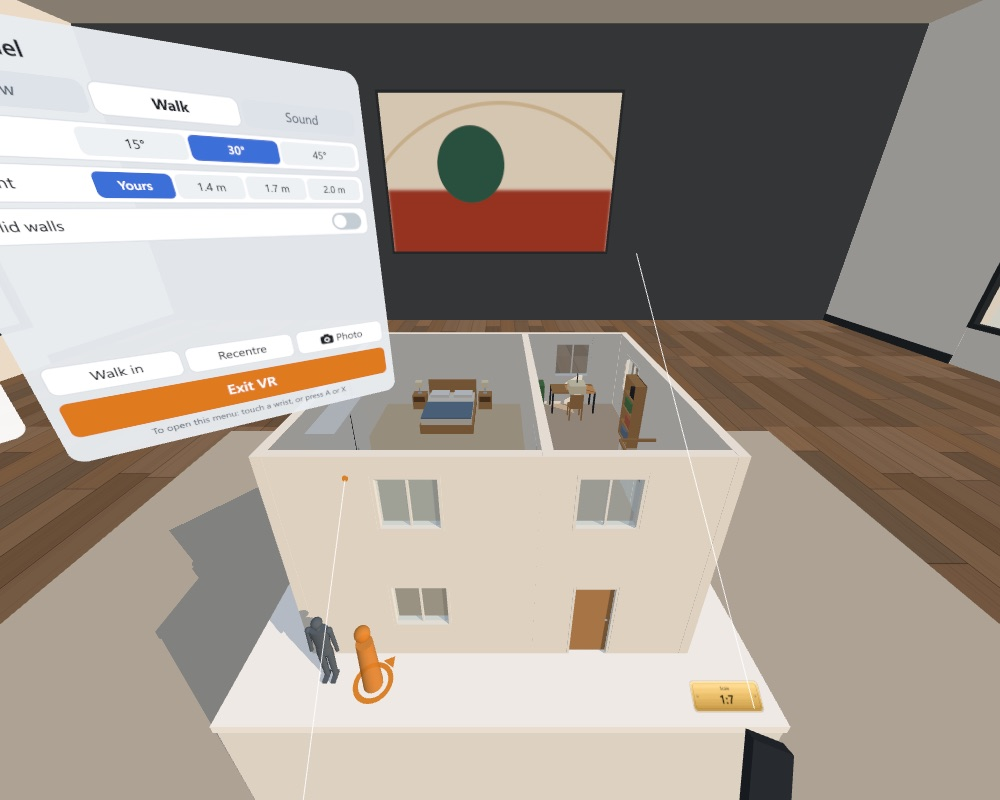

# CasaWalk VR

*Mi casa es tu casa.* Opens Sweet Home 3D files.

A WebXR viewer for [Sweet Home 3D](https://www.sweethome3d.com/) homes on Meta Quest. Open a `.sh3d` file directly (no export step), look at it as a scale model, then walk through it at real size. It also opens OBJ (plain, or zipped with MTL and textures) and GLB, including compressed GLB (Draco, meshopt).

**Try it: [casawalkvr.com](https://www.casawalkvr.com/)** (press *Try the example home* if you have no file to hand).

It runs in the Meta Quest Browser: no app store, no developer mode, no sideloading. The same page works on a desktop browser as a 2D preview, so you can check a file before putting the headset on.

| On the page | Scale model, in the headset | Walking inside |
| --- | --- | --- |
|  |  |  |

(Pictures: the example home that ships with the project. The headset views are from an emulated Quest 2.)

> Status: all planned work is done (see [SPEC.md](SPEC.md)): 2D preview, the scale model in VR and passthrough, walking at 1:1, time of day, shadows and depth shading, a safety audit, and offline use. Tested on a real Quest 2 only.

## Using it

1. Open the app's URL (GitHub Pages) in a browser.
2. **Open file**, drop a file anywhere on the page (on a computer), or paste a share link (Dropbox, Google Drive, OneDrive, GitHub; see [Links](#links-from-storage-services)) and press **Load**. No file to hand? **Try the example home**, a small two-storey house made for this viewer. The model's details show at the bottom right.
3. In the card at the top right, choose the **Time of day** (morning by default, noon, sunset or night), switch **Shadows** and **Depth shading** on or off, and press the big **Enter VR** button. The files card at the top left can be hidden with **–**.
4. Drag to orbit, scroll or pinch to zoom, right-drag to pan.
5. Next time, tap the model under **Recent**: the last 5 models are kept in the browser, so reopening one needs no download. For a model opened from a link, **↻** downloads the latest version from the same link (handy after editing the home on the Mac). The last link you used is also remembered in the link box.

**No typing in the headset:** open the model on a computer (a file, a dropped file or a link) and press **Send to my Quest**. Meta's "Open in VR" page opens (you need to be signed in to your Meta account, with the headset on and online); pick your headset, and the viewer opens there.

- **A model from a link** (Dropbox, the example): the link arrives filled in; press **Load**.
- **A file from the computer**: press **Receive** in the headset. The file goes straight from the computer to the headset, and while the computer's page stays open, every model you open on it goes to the headset too. **Unlink** on either side ends it. A model that arrives while you are in VR opens when you leave it.

The line under the button always says what will be sent.

### Links from storage services

Share the **file** (not its folder) with **"Anyone with the link"**, copy the link, and paste it:

| Service | Works? |
| --- | --- |
| Dropbox | Yes. |
| Google Drive | Yes. (A copy of the viewer on another address needs its own Google API key, below.) |
| OneDrive (personal) | Yes. |
| GitHub (a file page, or a raw link) | Yes. |
| Any other https address of the file | If that site lets other websites download it. |
| OneDrive for work or school, iCloud Drive, Box, WeTransfer, MEGA | No: these never let another website download a file. |

When a link can't be opened, the viewer says why and what to do instead. On the headset: open the link in a browser tab, download the file, then **Open file** and pick it from Downloads. On a computer: open the file and press **Send to my Quest**.

The OneDrive route uses the same anonymous steps as OneDrive's own page for visitors who aren't signed in. It isn't an official API and could change. The Dropbox link rewrite is unofficial too.

**Tip for Dropbox links:** a Dropbox shared link stays the same when you overwrite the file with the same name. Save your home under a fixed name (e.g. `My home.sh3d`), share it once, and on the Quest you only ever type that link once; after that use **↻**. Google Drive keeps the link too, if you replace the file with **Manage versions → Upload new version**.

#### Google Drive links: the API key (once per site)

Google only gives shared files to other websites through its Drive API, which needs a browser API key. The key is public by design, like the Dropbox app key, and it's free (no billing account).

1. In the [Google Cloud console](https://console.cloud.google.com/), create a project (any name).
2. **APIs & Services → Library**: find **Google Drive API** and press **Enable**.
3. **APIs & Services → Credentials → Create credentials → API key**.
4. Edit the key:
   - **Application restrictions → Websites**: add your site, e.g. `https://www.casawalkvr.com/*`. Add `http://localhost:*/*` too, to test locally.
   - **API restrictions → Restrict key → Google Drive API** only.
   - Save.
5. Put the key in `config.js` as `googleApiKey`, then commit and push.

Forks need their own key, restricted to their own address.

Supported files:

| Format | Notes |
| --- | --- |
| `.sh3d` | Saved with Sweet Home 3D 5.3 or later (the file must contain `Home.xml`). Re-save older files. |
| `.zip` | A renamed `.sh3d`, or a zip holding an OBJ/GLB/DAE/3DS model with its textures. |
| `.obj` | Pick the `.obj`, `.mtl` and texture files together. Units: Auto (largest size > 100 means cm), or choose cm / m / mm / in. |
| `.glb` / `.gltf` | Metres. Draco and meshopt compression are decoded. KTX2 textures can't be shown yet: the file's fallback images are used, or plain surfaces. |

**Quest Browser tip:** if picking a `.sh3d` file fails with "Quest Browser blocked this file type", rename it to `.zip`.

**Copying files from a Mac to the Quest by cable:** Android File Transfer is no longer maintained; the free [OpenMTP](https://openmtp.ganeshrvel.com/) works with a Quest 2. Connect the headset by USB-C, accept "Allow access to data" inside the headset, and drag the `.sh3d` into any folder (e.g. a new `CasaWalk` folder). Then use **Open file** in the Quest Browser.

## In the headset

Press **Enter VR** once a model is open. In the headset, the menu switches between VR and passthrough.

**Menu:** touch one wrist with the other hand (a glowing orb sits on each wrist), point at an orb and pull the trigger, or press **A** or **X**: the menu opens with a drawing of the controllers and what each button does. At the scale model it opens to your left, clear of the model; while walking, in front of you. **B** / **Y** or a click elsewhere closes it. When you enter VR, a welcome card above the home says how, until you first open the menu.

The menu has three tabs, **View**, **Walk** and **Sound**, the same in both menus, with the actions (Walk in or Back to the scale model, Recentre, Photo, Exit VR) below them on every tab. Settings are **switches** for what is on or off (Shadows, Depth shading, Ceilings, Figure, Passthrough, Solid walls), a row of **options** with the current one in blue where there are a few to choose from (Time of day, Turn, Height, Sound: one click, nothing to open), a **dropdown** for Levels (homes can have many) and a **slider** for See-through (pull the trigger on it and drag). A setting that belongs to the scale model is greyed out while walking. Settings, and the tab you last used, are remembered.

**Scale model**
- The home stands on a low museum plinth in a gallery room, 60 cm in front of you. You look down at it as a 2 m tall person would, whether you sit or stand, so it's easy to look into the rooms. If you change position, **Recentre** measures your height again. **Passthrough** (View tab) swaps the gallery for your own room; the model stays exactly where it is.
- **Thumbstick** left/right turns it; up/down zooms it (½× to 4×). A brass plate on the plinth shows its true scale (e.g. 1:42); let go of a zoom near a standard scale (1:10, 1:20, 1:25, 1:50, 1:100…) and it settles on it with a light tick.
- Point the **laser** at a room: an orange marker hops to the room's clear middle, with the room's name above it and a small arrow for the way you'll face. **Trigger** takes you there at real size. (Pointing at the garden, you land where you point, clear of the walls, facing the house. OBJ and GLB files have no rooms: you land where you point.)
- **Grip** and move your hand to lift it or move it; it never sinks into the plinth.
- A small grey **scale figure** (1.75 m at the model's scale) stands by the home's front corner, like the little people in architects' models, so you can judge its size.
- Menu: **Walk in** (at Sweet Home 3D's virtual visitor position), **Recentre**, **Photo**, **Exit VR**; View tab: **Time of day** (morning, noon, sunset, night), **Shadows**, **Depth shading**, **Ceilings**, **Figure**, **See-through**, **Levels** (in a home with several storeys: all of them, or up to a level, by its Sweet Home 3D name, with the ceilings off the top one shown), **Passthrough**.

**Walking, at 1:1**
- **Left stick** walks where you look. In a one-level home you stay on the floor and walk through furniture; in a home with several levels you can step onto anything, so stairs work.
- **Solid walls** (menu, off by default): walls stop you, whether you use the stick, pull yourself along or walk for real in your room, and you slide along them. Only walls: furniture, doors and windows stay walk-through, so doorways and stairs work. (OBJ and GLB files have no separate walls, so the switch is greyed out for them.)
- **Hold a grip** (the button on the side of the handle) and move your hand to pull yourself along, as if grabbing the room.
- **Right stick** left/right turns in steps (15°, 30° or 45°, set in the menu).
- **Right stick forward**, or **hold a trigger**, and aim: a blue ring shows where you'll land (red on a wall). The arc stays low enough to pass through doorways. Let go to teleport there.
- **B** or **Y** goes back to the scale model.
- Menu: the same tabs (Walk tab: **Turn**, **Height** (yours, 1.4, 1.7 or 2.0 m), **Solid walls**), and at the bottom **Photo**, **Back to the scale model** and **Exit VR**.

**Photo** (both menus): takes a picture of what you see, without the menu, lasers or controllers. It is kept in the viewer, and when you leave VR the page lists your photos: **Save all to Downloads** (or one by one) puts them in the Quest's **Files** app, in **Downloads**. (Nothing is downloaded during VR: the Quest Browser asks for permission at the first download, and its question would end the VR session. The first save on the page may ask once: choose Allow.) The viewer keeps your last 50 photos until you delete them. Use it instead of the Quest's own screenshot (Meta button + trigger): that trigger pull also reaches the viewer and makes you jump.

**Sound** (Sound tab): Off or Effects (a light tick when the zoom settles on a scale; the hand-held tools will add more).

**See-through** (headset only, both menus): a slider that fades walls and furniture, up to a glass house where only 15% of them is left, so you can see into every room at once. Floors and ceilings stay as they are. Faded walls and furniture cast no shadows, like glass. The 2D page always shows the home as modelled.

**Light and shadows:** the sun comes from the right direction for your home, using the compass in the Sweet Home 3D file. Shadows are off by default; when on, they are computed once (not every frame), so walking stays smooth. With ceilings on, sunlight only enters through the windows; turn ceilings off to let it in from above. At sunset and at night the home's lamps glow. The same settings are in the card at the top right of the 2D page; the light starts as morning.

**Depth shading** (headset only, off by default): soft dark gradients where walls, floors and ceilings meet and where furniture touches them, and a slightly different brightness for faces pointing different ways, so white walls don't melt into each other. Switch it on in the page's top-right card or with **Depth** in the headset menu. It is prepared once per model in the background (a few seconds; the menu shows a percentage) and costs nothing per frame afterwards.

## Which headsets

Built for and tested on a **Meta Quest 2**. It uses only standard WebXR, so:

- **Quest 3, 3S and Pro** should work as they are, with colour passthrough and more speed. The scripted test passes with their emulated controller layouts, but nobody has tried the real devices yet.
- **Quest 1** may work in VR only (it has no passthrough for web pages) with small homes: its processor is much slower, and Meta no longer updates its browser. Untested.
- Other WebXR headsets with two controllers that have a thumbstick, trigger, grip and two buttons should also work; hand tracking alone is not supported yet: with bare hands, pinches do nothing and a note asks you to pick up the controllers.

## What gets shown from a Sweet Home 3D file

Walls (including sloping and round walls, colours and textures per side), door and window openings, room floors and ceilings, furniture (including groups, mirrored and rotated pieces, colours and per-material colours), lights (as furniture), the ground and sky colours. Hidden items and hidden levels are skipped. Labels, dimensions, polylines and the compass are ignored.

## Hosting

The site is plain static files with no build step: GitHub Pages serves the repository root at [www.casawalkvr.com](https://www.casawalkvr.com/) (the `CNAME` file; a fork that hosts its own copy deletes it and uses its own GitHub Pages address). WebXR only works over HTTPS, so on the Quest use that address, not a local `http://` one.

### Dropbox Chooser (for your own copy)

The **Open from Dropbox** button uses Dropbox's official [Chooser](https://www.dropbox.com/developers/chooser). If you host your own copy, register your own key:

1. At [dropbox.com/developers/apps](https://www.dropbox.com/developers/apps) choose **Create app**, *Scoped access*, *App folder*, and a unique name.
2. In the app's **Settings**, add your site's domain (e.g. `yourname.github.io`) under **Chooser / Saver / Embedder domains**.
3. Put the **App key** (not the secret) in `config.js` as `dropboxAppKey`.

4. In `index.html`, add `https://www.dropbox.com` to `script-src` in the Content Security Policy, and add `frame-src https://www.dropbox.com`. Without this the page refuses to load Dropbox's script.

Without a key the button is simply hidden. The Chooser script is the only file loaded from another site (dropbox.com), and only when a key is set.

## Safety and privacy

- **Your home stays on your device.** Models are read in the browser. Nothing is uploaded, and there is no analytics or tracking. Recent models are kept in the browser's own storage (IndexedDB) on that device; remove them with the × beside each one.
- **Opening a model cannot contact other websites.** A model file can contain links to images on other servers. They are never followed (the status line says how many were ignored), so a file cannot be used to see who opens it.
- **Send to my Quest.** This uses Meta's [Web Launch](https://developers.meta.com/horizon/documentation/web/web-launch/): the viewer's address is handed to Meta's page so it can open on your headset, with the model's link or, for a file, a random one-time pairing name. Nothing is sent unless you press the button.
- **Sending a file to the headset.** The two devices are introduced by [PeerJS](https://peerjs.com/)'s free public server (set in `config.js`), which sees only the pairing name and connection details. The file then goes directly between them over an encrypted WebRTC connection; if your network blocks a direct path, PeerJS's relay passes the encrypted bytes along without being able to read them. The headset connects only after you press **Receive**, accepts at most 500 MB, and opens what arrives with the same checks as any file. The pairing name works once, for 10 minutes. The page contacts PeerJS only when you use this.
- **Links.** Only `https://` links are downloaded, up to 500 MB, without cookies or a referrer. Two services need one extra request first. For a OneDrive link, Microsoft's share API is asked for the file's download address. For a Google Drive link, Google's Drive API is asked, with the site's API key, and the site's address (not the page's full address) is sent so Google can check the key. A `?model=` address that points to another site is not opened automatically: it is put in the link box and waits for you to press **Load**.
- **Oversized files.** Archives that would unpack to more than 1 GB or 50,000 files are refused before unpacking, and textures above 2048 pixels are shrunk to fit a Quest 2's memory. The limits are in `config.js` and `js/formats.js`.
- **The page only runs its own code.** A Content Security Policy in `index.html` allows scripts from this site only, with the import map pinned by its hash. WebAssembly is allowed for the vendored Draco and meshopt decoders (never JavaScript `eval`). All libraries are vendored; nothing loads from a CDN. If you edit the import map, `npm test` tells you the new hash.
- **Offline.** After the first visit the app's own files are kept by a service worker (`sw.js`), so the page opens without internet and your Recent models still load. Online, it always asks the server for the current files.
- **What it cannot prevent.** A deliberately broken or enormous model can still make the browser tab slow or crash, as with any 3D viewer. It cannot reach your files, your account or other sites.

## Feedback

Problems and ideas are welcome as [issues](https://github.com/marcalnet/CasaWalkVR/issues). It helps to say:

- the headset and its browser version (or the desktop browser);
- what you did and what you expected;
- the numbers the page shows at the bottom right for the model (triangles, draw calls, walls, pieces);
- the file itself, if you are happy to share it. Homes are personal, so a small file that shows the same problem is just as good.

Things nobody has been able to check yet: a real Quest 3, 3S, Pro or Quest 1, Safari, very large homes (over a million triangles), and files written by old or unusual Sweet Home 3D versions.

## Development

The app is plain ES modules served as static files: there is no build step and nothing to install to run it. Clone it and the Node tests already work (Node 24; `nvm use` picks it up):

```bash
git clone https://github.com/marcalnet/CasaWalkVR.git
cd CasaWalkVR
npm test               # parser, lighting, depth-shading, headset and safety tests: no install, no downloads
npm run serve          # the app at http://localhost:8123/ (2D preview; WebXR on a headset needs https)
```

The browser-driven checks need the dev tools (Playwright and Meta's IWER headset emulator):

```bash
npm install            # dev tools only; the app never needs it
npx playwright install chromium
npm run shots          # screenshots of each test home into test-output/
npm run xr-test        # a scripted VR session on an emulated Quest 2: 118 checks and screenshots
XR_DEVICE=metaQuest3 npm run xr-test   # or oculusQuest1, metaQuestPro: their controller layouts
```

To check that a change looks exactly the same in the headset (a refactor), record a run before it and one after it and compare them; the instructions are at the top of `scripts/xr-test.js` (`XR_STEADY`, `XR_OUT`, `XR_BASELINE`, then `node scripts/xr-compare.js`).

Optional extras:

```bash
npm run fixtures       # download two public Sweet Home 3D example homes as more test files
npm run example        # rebuild examples/example-home.sh3d (after editing scripts/make-example.js)
npm run ui-assets      # redraw the draft interface artwork in assets/ui/
npm run vendor         # copy three.js, three-mesh-bvh, fflate and the font into vendor/ (after changing versions)
```

Every test runs on the example home in `examples/`. Downloaded fixtures and your own homes in `tests/fixtures/private/` (ignored by git) are picked up as well when present. Open a model directly with `http://localhost:8123/?model=examples/example-home.sh3d`.

To test on a headset, fork the repository and enable GitHub Pages on your fork (Settings, Pages, deploy from the `main` branch): WebXR needs https, and Pages gives you that with no setup.

Where to start reading: [SPEC.md](SPEC.md) is the brief the project was built from and records every decision and why; [CLAUDE.md](CLAUDE.md) holds the hard constraints and working rules. The project was written with [Claude Code](https://claude.com/claude-code), directed and tested on the headset by its owner; both files are what the assistant works from.

### Layout

```
index.html        2D UI and import map
config.js         Dropbox app key, Google API key, defaults
js/main.js        2D page, renderer, loading, UI
js/xr.js          VR/AR session: the frame order and the parts below
js/xr-dollhouse.js  the scale model on its plinth: turn, zoom, move, scale plate, where stepping inside lands
js/xr-walk.js     walking at 1:1: stick, teleport, snap turn, grip pull, floors and solid walls
js/xr-ui.js       wrist orbs, opening and pointing at the menu, welcome card, photo note
js/xr-menus.js    what the headset menus say and do (cells defined once, rows of ids)
js/xr-scene.js    gallery room, plinth, skies, markers, scale figure
js/xr-targets.js  what the lasers, the teleport arc and your feet can hit (no DOM)
js/xr-tools.js    the hand-held tool system (the tools arrive later)
js/xr-input.js    controllers, lasers, buttons, thumbsticks, teleport arc
js/settings.js    every remembered setting, its key and meaning
js/tween.js, js/haptics.js, js/sound.js   feedback: motion, vibration, synthesised sounds
js/panel.js       canvas-texture VR menu (switches, options, slider, buttons) and controls card
js/walls.js       solid walls while walking and see-through walls and furniture (headset only)
js/photo.js       the menu's Photo button: renders the view without the menu as a JPEG
js/rooms.js       where stepping inside lands: a room's clear middle and long direction (no DOM)
js/theme.js       fonts, colours and corner radii of everything drawn in the headset
assets/ui/        replaceable interface artwork (draft textures; see its README)
js/lighting.js    time of day (sun from the home's compass) and shadows
js/depth.js       depth shading for the headset: corner gradients baked per vertex
js/optimise.js    merge geometry by material, BVH for raycasts
js/storage.js     recent models (IndexedDB)
js/links.js       which links may be downloaded; Dropbox, Google Drive, OneDrive, GitHub links; Send to my Quest address (no DOM)
js/transfer.js    sending a file to the headset: the protocol and its checks (no DOM)
js/pairing.js     the direct computer-to-headset link (PeerJS)
js/sh3d.js        SH3D parser and scene builder (no DOM; Node-testable)
js/formats.js     zip / OBJ / GLB / DAE / 3DS loading, unit detection
sw.js             service worker: offline use, and no mix of old and new files after an update
examples/         the generated example home (original content, made by scripts/make-example.js)
vendor/           three.js, three-mesh-bvh, fflate, PeerJS and the Kalam font (with licences)
scripts/          vendoring, fixtures, example home, local server, screenshots, emulated headset test
tests/            Node tests
docs/             pictures for this README
```

### Updating three.js

Change the versions in `package.json`, then `npm install && npm run vendor`, run the tests and screenshots, and commit `vendor/`.

## Credits

- This project: MIT licence (see [LICENSE](LICENSE)).
- [three.js](https://threejs.org/) (MIT), [three-mesh-bvh](https://github.com/gkjohnson/three-mesh-bvh) (MIT), [fflate](https://github.com/101arrowz/fflate) (MIT).
- [PeerJS](https://peerjs.com/) (MIT) for the computer-to-headset link.
- The handwriting on the welcome notes is [Kalam](https://fonts.google.com/specimen/Kalam) by Indian Type Foundry (SIL Open Font Licence 1.1; licence in `vendor/kalam/`).
- Sweet Home 3D by Emmanuel Puybaret / Space Mushrooms. This project reads its file format; it contains no Sweet Home 3D code.
