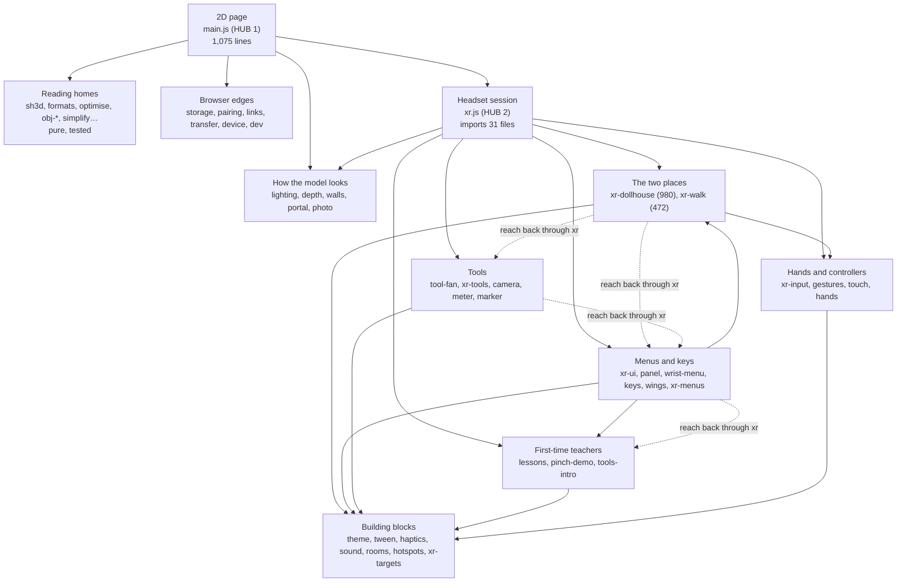

# CasaWalk VR: architecture audit

*26 November 2026. An independent, read-only audit: no code was changed. It looked at a frozen copy of the code at commit `d6bd5a5` (local `main`, one commit ahead of the live build 138), so the work in progress on fewer draw calls (stage B3) is not in it. `npm test` was run on that copy; the emulated headset test was not (another session was using it).*

**Who this is for.** The project's owner, who is a graphic designer, not a developer. Every technical word is explained the first time it appears, and there is a short glossary at the end.

---

## The answer in six lines

1. **Your request is sensible, and the app is already partly built that way.** About half the code is in small, single-purpose, tested files. The other half (everything you touch and see in the headset) is organised around one central "hub" that every part reaches into.
2. **Since the last audit (24 November) the safety work was done well:** a safety net for errors, automatic checks, a heavy test home, the leftovers deleted, one base for drawn cards. Stage A is complete.
3. **But the headset side kept growing in the same shape.** In two days it gained about 2,300 lines; the scale-model file grew from 689 to 980 lines and is now the most overloaded file, ahead of `xr.js`.
4. **The next build (tip screens, free teleport, one settings wing, either-hand teleport, tool dials, tools and orb by areas) lands mostly on the weakest places**: who owns a pinch, the order of things in each frame, and the first-time teachers spread over many files.
5. **Recommendation: delete first, then two targeted restructures, then the features.** Your approved simplicity cuts are also the cheapest structural improvement: they remove about 1,500 lines, four files and roughly half the special cases in how a hand is shared. Do them before restructuring anything, so nothing is moved that is about to go. Keep B3 tonight; move B1 and B2 (loading and the 2D page) to after the next build, which doesn't touch them.
6. **Plan:** step 1, delete the approved cuts; step 2, the tip screens as a "pause" module that owns moving between places, with the old first-time teachers deleted just before it; step 3, one place that decides who owns each hand ("the hand arbiter"); then session state and the features. Details in Part 6.

---

## Part 1. The map

### 1.1 Where we are

- **Build number:** `js/version.js` says **138** (the live build). Local `main` has one more commit (Interaction harmony, group 5), so the next stamp will read 139 or more.
- **Size:** 66 files in `js/`, **15,958 lines** (24 Nov: 51 files, 13,608 lines). Tests: 36 files, 4,555 lines.
- **Tests today:** `npm test` runs **236 tests in about 6 seconds: 235 pass, 1 is marked "to do"** (the heavy test home is over the draw-call budget: 193 against 100, which B3 is meant to fix).

### 1.2 What a "file" and an "import" are

Each file in `js/` is a **module**: a piece of the program with a job. When one module needs another, it **imports** it (names it at the top). The imports are the wiring diagram: if file A imports file B, changing B can break A. A module that imports nothing and is imported by many is a safe building block; a module that imports twenty others is a **hub**, and a change anywhere can reach it.

### 1.3 Every file, grouped by area

*Lines* = the file's length. *Imports* = the other CasaWalk files it uses (three.js and vendored libraries left out). ✓ in *Pure* = it runs without a browser, so it can be tested in Node in milliseconds.

**The 2D page and the browser** (1,677 lines)

| File | Lines | Job | Imports | Pure |
|---|---|---|---|---|
| `main.js` | 1,075 | The 2D page: renderer, loading a home, Recent and photos lists, Send to my Quest, welcome notes, updates, test hooks | 17 files: build-label, depth, dev, device, formats, lighting, links, obj-worker-client, optimise, pairing, photo, samples, settings, simplify, storage, transfer, version, xr | |
| `storage.js` | 192 | Recent homes and VR photos in the browser's database | – | ✓ |
| `pairing.js` | 239 | The computer-to-headset link (Send to my Quest) | transfer | |
| `settings.js` | 74 | Every remembered setting: name, default, allowed values | lighting | ✓ |
| `samples.js` | 36 | The sample homes, as data | – | ✓ |
| `device.js` | 16 | Which device this is (the one place that reads the browser's name) | – | ✓ |
| `dev.js` | 20 | The development switches in the address (?test, ?hands, ?stats, ?nomerge, ?sw, ?worker) | – | ✓ |
| `build-label.js` | 22 | How the build number reads; the newer-build check | – | ✓ |
| `version.js` | 3 | The build stamp | – | ✓ |

**Reading homes ("the engine room")** (2,783 lines)

| File | Lines | Job | Imports | Pure |
|---|---|---|---|---|
| `sh3d.js` | 825 | Reads Sweet Home 3D files and builds walls, rooms, furniture | – | ✓ |
| `formats.js` | 607 | OBJ, zip, GLB, DAE, 3DS loading; unit detection | obj-core, obj-defaults, sh3d, simplify, triangles | |
| `optimise.js` | 247 | Merges the home into few pieces by material; BVH (fast hit-testing) | – | ✓ |
| `obj-core.js` | 212 | OBJ reading shared by the page and the background worker | obj-defaults, simplify | ✓ |
| `obj-defaults.js` | 194 | Sweet Home 3D's built-in OBJ colours, see-through panes | – | ✓ |
| `simplify.js` | 144 | Simplifies heavy models for the Quest | – | ✓ |
| `triangles.js` | 107 | Counts a home's triangles before building; refuses calmly if too heavy | – | ✓ |
| `links.js` | 252 | Which links may be downloaded; Dropbox/Drive/OneDrive/GitHub links | – | ✓ |
| `transfer.js` | 130 | The Send to my Quest protocol and its checks | – | ✓ |
| `obj-worker.js` / `obj-worker-client.js` | 17 / 48 | OBJ reading in the background (only with ?worker) | obj-core / – | ✓ |

**How the model looks** (1,318 lines)

| File | Lines | Job | Imports | Pure |
|---|---|---|---|---|
| `lighting.js` | 261 | Time of day, sun, lamps, on-demand shadows | – | |
| `depth.js` | 330 | Depth shading baked into corners | – | |
| `walls.js` | 219 | Solid walls; see-through walls and furniture | – | |
| `portal.js` | 388 | The wall portal (a circle opens in a wall you touch or come close to) | optimise, theme, tween | |
| `photo.js` | 120 | Renders a photo without the interface; saves a JPEG | – | |

**The headset session (the hub)** (1,044 lines)

| File | Lines | Job | Imports | Pure |
|---|---|---|---|---|
| `xr.js` | 835 | Starts and ends VR; builds every headset part; moving between places (layers); the order of work in each frame; shared state | **31 files** (every headset module) | |
| `safety.js` | 106 | The safety net: a calm card on errors, a clean exit after repeated ones | – | ✓ |
| `veil.js` | 103 | The one sphere round the eyes (fades, tunnel, photo flash) | – | |

**The two places: scale model and inside** (2,146 lines)

| File | Lines | Job | Imports | Pure |
|---|---|---|---|---|
| `xr-dollhouse.js` | 980 | The scale model: plinth and its height changes, doors, level keys, grab, float and glide home, hover aim, hand aim, zoom and round scales, where stepping inside lands | gestures, keys, panel, rooms, theme, touch, tween, xr-input, xr-scene, xr-targets | |
| `xr-walk.js` | 472 | Inside: teleport (controllers and hands), snap turn, stick walk, grip slide, floor following, solid walls | gestures, hotspots, panel, walls, xr-input, xr-scene, xr-targets | |
| `xr-scene.js` | 346 | Scenery: gallery room, plinth, skies, markers | – | |
| `xr-targets.js` | 135 | What lasers, the arc and the feet may hit; the "claim" distances | optimise | ✓ (mostly) |
| `rooms.js` | 157 | A room's clear middle and long direction | – | ✓ |
| `hotspots.js` | 56 | Teleport hotspots: room middles, doorways | rooms | ✓ |

**Hands and controllers** (1,266 lines)

| File | Lines | Job | Imports | Pure |
|---|---|---|---|---|
| `xr-input.js` | 474 | Controllers, lasers, sticks, the arc; per-frame button "claims"; bare hands told apart | gestures, theme, touch | |
| `gestures.js` | 209 | Bare-hand gestures from the finger joints (pinch, flick, fist, aim ray) | – | ✓ |
| `touch.js` | 117 | Touch keys: hover, contact, click, release | – | ✓ |
| `hands.js` | 149 | Drawn bare hands, fingertip glow | hand-model, theme | |
| `hand-model.js` / `hand-poses.js` | 160 / 80 | The hand model and preset poses | theme / hand-model | |
| `transient-pointer.js` | 77 | Apple Vision Pro's look-and-pinch (isolated) | xr-targets | |

**Menus, keys and boards** (2,732 lines)

| File | Lines | Job | Imports | Pure |
|---|---|---|---|---|
| `xr-ui.js` | 636 | The two wings (opening, placing, closing), welcome card, notes, photo feedback, error card, routing touches and lasers to boards | 13 files: build-label, gestures, guide, lessons, panel, theme, touch, version, wings, wrist-menu, xr-dollhouse, xr-menus, xr-targets | |
| `panel.js` | 752 | Drawn boards (switches, choices, tabs), cards, labels, the scale plate | canvas-card, theme | |
| `wrist-menu.js` | 331 | The orb and its arc of keys | keys, theme, tween, xr-input, xr-targets | |
| `keys.js` | 337 | Keys pressed by touch or laser, held keys | canvas-card, theme, touch | |
| `xr-menus.js` | 299 | The boards as data (cells, tabs), help, what each key and setting does (one long switch) | guide, lighting, panel, settings, theme | |
| `wings.js` | 153 | Where the wings go (never over the model) | – | ✓ |
| `guide.js` | 80 | The How to move pictures and lines | theme, xr-menus | ✓ |
| `theme.js` | 121 | Fonts, colours, corner radii, some sizes | – | ✓ |
| `canvas-card.js` | 23 | The one way every drawn card makes its picture | – | |

**Hand-held tools** (1,737 lines)

| File | Lines | Job | Imports | Pure |
|---|---|---|---|---|
| `tool-fan.js` | 484 | The tool fan: opening on a look, taking, swapping, putting back, docked tools, sliding aside from the orb | laser-meter, marker-tool, panel, street-camera, tween, wings, xr-targets | |
| `xr-tools.js` | 131 | The frame every tool plugs into (which buttons it owns, what it made) | – | |
| `tool-models.js` | 321 | The three tools' 3D models | theme | |
| `street-camera.js` | 229 | The camera: shutter, viewfinder, lens, print | canvas-card, device, theme, tool-models | |
| `laser-meter.js` | 267 | The laser meter: beam, reading, measured lines | canvas-card, measure, theme, tool-models | |
| `marker-tool.js` | 227 | The marker: strokes, colours, undo | tool-models | |
| `measure.js` | 78 | Measuring maths and labels | – | ✓ |

**First-time teaching** (709 lines)

| File | Lines | Job | Imports | Pure |
|---|---|---|---|---|
| `lessons.js` | 252 | Lesson cards that tick off steps | canvas-card, hand-model, hand-poses, keys, settings, theme, xr-menus | |
| `pinch-demo.js` | 249 | The looping pinch hand the first time inside | hand-model, hand-poses, lessons, panel, settings, theme | |
| `tools-intro.js` | 208 | The tools' show above the scale model | gestures, panel, settings, tool-models, wings | |

**Feedback ("feel")** (419 lines): `tween.js` 111 (smooth motion), `haptics.js` 77 (vibration patterns), `sound.js` 231 (synthesised sounds). None imports another CasaWalk file; all are pure.

**Development aids** (127 lines): `hand-readout.js` 83 (?hands), `frame-stats.js` 44 (?stats).

### 1.4 The dependency map

Each box is an area from the tables above; an arrow means "uses". The two hubs are marked.

The solid arrows are tidy: everything flows down from the two hubs to building blocks. **The dotted arrows are the problem.** Every headset part is handed the hub (`xr`) when it is built, and then reaches *through* it into other parts: the scale model checks whether the tools' show is playing, the tool fan writes a flag on the wrist menu, the menu code resets walk mode's body. These links don't appear in any import line, so they are invisible in the wiring diagram. I counted **59 such reach-throughs in 15 files** (`tool-fan.js` alone has 15) and **54 places that use "if it exists" checks** on the hub's parts (`xr.lessons?.note`, which quietly does nothing when a part isn't there yet).

---

## Part 2. Judging each area against your three goals

Your goals: **(1)** one section can be rewritten without touching the rest; **(2)** each section has one job; **(3)** a problem is found quickly.

### 2.1 Summary score

| Area | (1) Rewrite alone | (2) One job | (3) Easy to debug | Notes |
|---|---|---|---|---|
| Reading homes | ✓ | ✓ | ✓ | Pure, tested, no page code. Keep as it is. |
| Building blocks (rooms, hotspots, touch, gestures, measure, wings, safety, tween, sound…) | ✓ | ✓ | ✓ | Small, pure, tested. The healthiest part of the app. |
| How the model looks | ~ | ✓ | ~ | Each file has one job, but four of them change the model's materials in an order fixed by three lines of `main.js`. |
| Browser edges | ✓ | ✓ | ~ | `storage.js` is still untested. |
| Tools (camera, meter, marker) | ✓ | ✓ | ✓ | Each tool plugs into a small, written contract (`xr-tools.js`). A good pattern. |
| Tool fan | ✗ | ~ | ✗ | 484 lines, 32 tuned numbers, 15 reach-throughs. It decides its own opening by measuring distances to every other part. (The planned areas replace this: Part 6, steps 1 and 3.) |
| Menus and keys | ~ | ~ | ~ | Boards are data (good: tabs are lists of cell names). But `xr-ui.js` does six jobs, and settings changes go through one 90-line switch. |
| First-time teachers | ✗ | ✓ | ✗ | Each teacher is its own file, but who plays when is decided in `xr.js`, `xr-menus.js`, `xr-ui.js`, `xr-dollhouse.js` and `tool-fan.js`. |
| The scale model (`xr-dollhouse.js`) | ✗ | ✗ | ✗ | 980 lines, at least eight jobs (below). |
| Inside (`xr-walk.js`) | ~ | ~ | ~ | Better than the scale model, but its hand teleport is a near copy of the scale model's. |
| Headset session (`xr.js`) | ✗ | ✗ | ~ | Clearly written and commented, but it is the place every part depends on. |
| 2D page (`main.js`) | ✗ | ✗ | ✗ | Eight jobs in one untested script; the next build barely touches it. |

✓ = yes, ~ = partly, ✗ = no.

### 2.2 The suspected overloaded files

**`xr.js` (835 lines, was 656).** It is not messy: it is well commented, and its jobs are listed at its top. But it has five jobs:
1. builds every headset part (31 imports);
2. starts and ends the session;
3. runs the move between places (the walk-in grow, the tunnel zoom, the fades, the arrival title: about 160 lines of timing written by hand);
4. holds the shared state every part reads and writes (`lift`, `plinthH`, `maxStorey`, `personHeight`, `view`, `solid`…);
5. decides pinch rules for everyone: `aimBlock` (seven reasons a pinch may not aim), `teleportHand`, `nearKey`.

And `update()`, the work done every frame, is a list of 25 calls in an order that matters ("its keys before the mode's lasers"). Adding anything to a frame means finding the right line in that list.

**`main.js` (1,075 lines, was 1,058).** Unchanged in shape: renderer, loading, network, Recent and photos lists, Send to my Quest, welcome notes' layout, updates, test hooks, twelve loose variables. It is the weakest file, but **it is not where the next build happens.** It matters for the store and for opening homes inside VR, which come later.

**`xr-dollhouse.js` (980 lines, was 689): now the most overloaded file.** It holds:
1. the plinth's height and its animated change between controllers (0.60 m) and bare hands (1.24 m);
2. the doors on the plinth and their fading;
3. the level keys;
4. grabbing the model;
5. floating, the 4 s return ring and the 1.6 s glide home;
6. the hover aim before a pinch;
7. the bare-hand aim and stepping inside;
8. the stick zoom and settling on round scales;
9. where stepping inside lands.

Three of these (1, 6/7 and 8) are exactly what the next build changes or removes.

**`xr-ui.js` (636 lines)**: wing placement, the welcome card, the hands note, the error card, photo feedback, routing touches and lasers to the boards, and the "a press at empty space closes the wings" rule. It imports `xr-dollhouse.js` for one small function (`headHeading`), which ties the menus to the scale model.

**`tool-fan.js` (484 lines)**: correct, but it does its own collision rules with every other part (keys, orb, wings, model, eyes) and writes a flag onto the wrist menu (`fanYield`). The interaction harmony fixes of today touched it in four of five groups.

### 2.3 Duplicated logic

| What | Where | Why it matters |
|---|---|---|
| **Bare-hand pinch → aim → let go → land**, with "the landing from 0.1 s before" | `xr-walk.js` `handMoves`/`landingBefore` and `xr-dollhouse.js` `handMoves`/`spotBefore`: about 50 lines each, the same conditions word for word (`teleportHand`, `aimBlock`, the waist check) | "Either hand teleports" and "first one wins" must be changed twice and kept the same twice. |
| **Controller trigger → aim → land** | separately again in each place | Four teleport paths in all (2 places × 2 inputs). |
| **"May this hand act here?"** | `aimBlock` in `xr.js`, `nearKey` in `xr.js`, the fan's own key rules (`tool-fan.js`), the orb's yielding (`wrist-menu.js`), `notEmpty` (`xr-ui.js`), each mode's local `busy` | One shared distance table now (`CLAIM`, 15 and 25 cm: today's group 1, a good step), but still five places that apply it, each a little differently. |
| **Plinth rest height** | `PLINTH_REST` exists in `xr-scene.js`, yet `xr.plinthH + 0.004` is typed 7 times in `xr-dollhouse.js` | Small, but typical. |

Controller code against bare-hands code: the *reading* of hands and controllers is well separated (`xr-input.js`, `gestures.js`, `touch.js`). The duplication is one level up, where each mode decides what a pinch or a trigger *means*.

### 2.4 Numbers and settings in the middle of the logic

- **Good:** most tuned numbers are named and commented at the top of their file (35 in `xr-dollhouse.js`, 32 in `tool-fan.js`, 16 in `xr-input.js`), and colours and fonts are in `theme.js`. The comments record *why* (often "the user's Quest 2 note"), which is valuable.
- **Not good:** they are spread over about 20 files, so the Tester checking the UX handbook's sizes, distances and angles still has to read code. A few remain inline (the tunnel's timings sit in one line in `xr.js`; `+ 0.004` above; the layer move's 0.15/0.2/0.3 s in `runLayerFx`).
- **Settings:** the registry (`settings.js`) is good. But each setting is copied into a field on the hub when VR starts (`xr.personHeight = readSetting('height')` in the constructor, read once), then changed by a 90-line switch in `xr-menus.js` that sets the field, saves it, applies it and redraws, case by case. Adding a setting means editing four places. "Per session" settings (the shared-headset rule) have no place to live yet.

### 2.5 Shared state that many files change

Parts write directly into the hub: `xr-walk.js` sets `xr.lift` and moves `xr.rig`; `xr-dollhouse.js` sets `xr.plinthH`, `xr.plinthSize`, `xr.lift`, `xr.stage.visible`; `xr-menus.js` sets `xr.view`, `xr.personHeight`, `xr.maxStorey`, `xr.cameraLens`, `xr.solid`, `xr.seeThroughAmount`, and resets walk mode's private `body`; `tool-fan.js` writes `xr.ui.wrist.fanYield`. Flags are also stuck onto controller objects (`c.pull`, `c.fistClaimed`) and hand views (`handViews[i].near`, set by keys, read by modes).

**Bug B1 (the plinth keys vanishing after a home was loaded while they were faded) was exactly this kind of bug:** one value (a material's opacity) shared by several things, changed by one of them, never restored. More of this kind will appear as the next build changes when things show and hide.

---

## Part 3. Debugging: how fast is a fault found today?

### 3.1 What exists, and it is good

| Aid | What it does | Verdict |
|---|---|---|
| **Safety net** (`safety.js`) | An error in the headset shows a calm card; repeated errors end the session; the last error is shown on the page afterwards. Handles Meta's menu covering the app. | Done since 24 Nov. A real improvement: faults are visible instead of a frozen view. |
| **Development switches** (`dev.js`) | `?test` (test hooks), `?hands` (bare-hand readout over each wrist: shows *why* a pinch is blocked), `?stats` (frame rate and draw calls in the headset), `?nomerge` (skip merging, to tell merge bugs from reading bugs), `?sw`, `?worker` | All in one file now. `?hands` is the best debugging tool in the app: it answers "why didn't my pinch work?" |
| **Node tests** (`npm test`) | 236 tests, 6 seconds, no install; the whole headset session can be driven in Node with a stand-in renderer (`tests/xr-session.test.js`, 1,433 lines, doubled since 24 Nov) | Strong. Pure modules are well covered. |
| **Automatic checks** | GitHub runs `npm test` on every push and warns if the build wasn't stamped | Done since 24 Nov. |
| **Heavy test home + budget test** | Reports draw calls, triangles and texture memory for a heavy home | Done. It shows 193 draw calls today (budget 100): B3's target. |
| **Emulated headset** (`npm run xr-test`) | A fake Quest 2 or Quest 3 in a browser, with screenshots | Useful, but one 2,027-line script (was 1,825) with 307 reaches into internals (was 263). Every restructure has to edit it in step. |
| **Comments** | Most rules carry the reason and the test that found them | Excellent; this is what makes a gradual restructure safe. |

### 3.2 What is missing

1. **No way to switch one interaction feature off.** You can turn off merging (`?nomerge`), but not the tool fan, the portal, the hover aim, the tunnel zoom or a teacher. When two features fight (the "interaction harmony" conflicts of today), there is no quick way to ask "does it still happen without the fan?". The tunnel zoom has an on/off constant, but it needs a code edit.
2. **No record of decisions.** When a pinch does nothing, the answer is in one of six places. `?hands` shows `aimBlock`'s reason, but not the fan's, the orb's, the wing's or the mode's own `busy`. One place that decides ownership (Part 6, step 1) would also be one place that can say "the left pinch went to: fan, because…".
3. **No log you can read in the headset.** Only about 16 lines in the whole app write to the console, and reading the console on a Quest needs a cable and a computer. A small `?log` switch showing the last few warnings and decisions on a card would let you report "it said X" from a voice note.
4. **Tests for the interaction rules sit mostly in the emulator script**, which is slow (minutes per device), cannot run while another session uses it, and has known random failures. The Node session test is the right home for them and is already growing.
5. **No test for loading or the 2D page** (`main.js`, `storage.js`): unchanged since 24 Nov.

---

## Part 4. Feature fit

"Fit" means: when the feature was added, did it go into one or two files, or did it need small edits all over? The first is a sign of good structure; the second is a sign the feature crosses a weak seam.

### 4.1 What was built in builds 120–138 (24–26 Nov)

| Feature | How it went in | Fit |
|---|---|---|
| **The wall portal** (and its bigger size) | Its own new file (`portal.js`), two commits, the rest of the app barely touched; the arc passing through it was one change in `xr-targets.js` | **Good.** The model for how features should land. |
| **Thumb and index glow** | A small table in `hand-model.js` | **Good.** |
| **The safety net, devices, dev switches, drawn cards, the veil** (stage A) | New small files, each with tests | **Good.** |
| **Round scales 1:25 and 1:30** | Two small functions in `xr-dollhouse.js`, used by `xr.js` | **Fair.** Works, but they live inside the overloaded file. |
| **Plinth's eased return and ring; taller bare-hands plinth** | All inside `xr-dollhouse.js`, which grew by 290 lines; the plinth height is now shared state (`xr.plinthH`) changed in four functions and read by `xr.js` and the scenery | **Poor.** The animated height switch between inputs is a lot of code that the next build deletes. |
| **Wrist menu with a three-key arc; the orb closing everything** | `wrist-menu.js`, plus changes to `xr-ui.js`, `xr-menus.js`, `tool-fan.js` and the tests | **Fair.** The menu itself is contained; "closing everything" had to be wired into each part. |
| **Wings at 45°** | `wings.js` (pure, tested) plus `xr-ui.js` | **Good** for placement; the open/close rules were spread (three commits). |
| **Docked tools with bare hands; repulsion from the orb; tools clear of the level keys** | `tool-fan.js` grew with distance rules against every other part, and writes a flag onto the wrist menu | **Poor.** It worked, but four of today's five "interaction harmony" fix groups had to go back into `tool-fan.js` and `xr-ui.js`. |
| **Bug B1** (keys vanishing after walk mode) | A shared material opacity, overwritten by one part and never restored | A symptom of shared state (2.5). |

**What the history shows:** the build-111 change touched 23 files in `js/` in one commit; the build-120 change touched 18; today's five "interaction harmony" fix groups touched 4–7 files each. Self-contained features (portal, glow, stage A) landed cleanly. **Features that change who owns a hand, or when something appears, needed edits across many files and then several rounds of fixes.** That is the seam to strengthen.

### 4.2 The real queue (the next build)

| Feature | Where it lands | Risk today | Why |
|---|---|---|---|
| **Tip screens between places ("the pause")** | `xr.js` (the move between places, start of VR, frame order), the four teachers it retires (lessons, pinch demo, tools' show, orb's call, arrival title) and their hooks in `xr-menus.js`, `xr-ui.js`, `xr-dollhouse.js`, `tool-fan.js`, `wrist-menu.js` | **High** | The move between places is hand-timed code inside `xr.js`; the teachers are wired into 5–10 files each (about 36 references to the lessons alone). It also needs a new "is the room ready?" check (frame times). Done as a patch, it would be the biggest edit of `xr.js` yet. **Done as its own module, it is the chance to remove 700 lines.** |
| **Free teleport** | The landing rules: `xr-targets.js` (pure, tested), the walk aim in `xr-walk.js`, floor following, and `sh3d.js` for stair names | **Low to medium** | The rules part is pure and testable in Node: a good fit. The "snap beside furniture" search is new geometry, also pure. The medium part is that the walk aim exists twice (hands and controllers). |
| **One settings wing with three tabs** | `xr-menus.js` (tabs are data), `xr-ui.js` (two wings become one), `panel.js` | **Low to medium** | Tabs are already lists of cell names, and How to move is already a drawn cell. Removing the second wing removes code. Any "which tab opens first" rule needs a small piece of session state. |
| **Round held ← Back key** | `wrist-menu.js`, `keys.js` (held keys exist already: the plinth's Back door), and the B/Y hold with a ring on the orb in `xr-input.js`/`wrist-menu.js` | **Low to medium** | The held key and ring exist; moving them to the wrist is contained. B/Y "hold, not press" changes how a controller button is claimed. |
| **One plinth height** | `xr-dollhouse.js`, `xr-scene.js`, `xr.js` | **Low** (a deletion) | Removes the animated switch, two constants and shared state. It makes everything else easier: do it early. |
| **Either hand teleports, first wins** | `teleportHand` in `xr.js`, *and* the copied conditions in both `handMoves`, *and* the controller paths | **Low, if done as a deletion** | Added as a new rule it would be medium to high (no single place knows which hand owns the teleport). But it is really a removal: delete `teleportHand` and the "other hand" note from both places. "First wins" then comes for free, because each place already ignores a second pinch while one hand aims. |
| **One option dial per tool** | A new dial widget; each tool gains one option; `measure.js` gains feet and inches | **Low to medium** | The tools' contract (`xr-tools.js`) is a good seam: add `option` to it and one shared dial. The medium part: "while the dial is open it owns the other hand's pinch" is again an ownership rule. Feet and inches is pure and testable. |
| **Camera framing guide** | `street-camera.js` (one raycast, one frame on the interface layer) | **Low** | Self-contained, like the portal. |
| **Tools and orb by areas** (added 26 Nov, from your build 138 test): left, centre and right areas; the tools always full size over the left hand or controller while it is in the left area, otherwise waiting at the left edge; untouched while the other hand is within reach of them | `tool-fan.js` (its opening and distance rules), `wrist-menu.js` (the `fanYield` flag), `xr-input.js` (the watch pose), a new small pure module for the areas and the slowly followed body direction | **Low, if done with the hand arbiter** | It is mostly a **deletion**: the raise-to-open and watch pose, the docked row, the orb's sliding field, the fan's fades near keys, the model and the eyes, and the "fan closed under a wing" rule all go. What replaces them is one question per frame, "which area is each hand in?", which is pure and testable in Node. Added on its own as a patch it would be medium (the fan still measures every other part); asked of the arbiter, it is a few lines. It also fixes the build 138 fault where the tools fled from the hand reaching to take them. |
| **Shared-headset rules** | `settings.js` (which settings are remembered and which last one VR session), `xr.js` (settings are read once, when the page loads), session state for "seen this session" | **Low to medium** | Today every setting is read once per page load, and there is no "this session" store. A small one fixes that and also serves the tip screens. |

**The pattern:** four of the ten (the tip screens' practice teleport, the dials' ownership, the held Back key on B/Y, the tools' areas) depend on **who owns a hand right now**, and two (tip screens, shared headset) depend on **"this session" state** that has no home. Several more (one plinth height, either hand, one settings wing) are mostly deletions, and they shrink the ownership problem before anyone restructures it.

---

## Part 5. Verdict

**Is your request sensible?** Yes. Modular sections with one job each, and faults found quickly, are exactly what keeps a fast-moving app changeable. They matter more here than usual, because the code is written by several AI sessions and tested on one Quest 2: every feature that "fights" another costs your headset time.

**Is the app already built this way?** **Partly.**
- **Fully** for reading homes, the building blocks, the tools themselves and the stage A work: about half the code.
- **Not** for the headset's interaction layer (the hub, the two places, menus, the fan, the teachers): the part you see and touch, and the part that changes every day.

**Restructure now, or later?**

- **A full restructure now: no.** The earlier audit's reasons still hold: the knowledge lives in hundreds of tuned details that only your Quest 2 can re-check, and the tests would have to be rewritten along with the code.
- **Carry on as before: no.** The next build sits on the two weakest seams. Done as patches, it would add a fourth and fifth round of "interaction harmony" fixes, and `xr.js` and `xr-dollhouse.js` would grow again.
- **Recommended: delete first, then two targeted restructures, then the features.**
  - **Delete before restructuring.** Your simplicity decisions are not only about what people see: most of them also remove files, imports, shared state and hand-sharing rules (Part 6.1). Moving code that is about to be deleted is wasted work, and every rule left in place is one more the new structure must copy.
  - **Then the tip screens as their own module** (replacing the old first-time teachers, deleted the commit before), **then one hand arbiter.**
  - **Build each new feature as its own module**, as the portal was.
  - **Change the order of stage B:** B3 tonight as planned; B1 and B2 after the next build, because the next build doesn't touch the 2D page or loading, and in-VR opening (which needs B1) is later.

---

## Part 6. The plan

### 6.1 First: which approved cuts also simplify the structure

Your simplicity decisions remove features. Some of them remove only what people see; others also remove **files, imports, shared state or "who owns this hand" rules**. Those second ones are worth doing *before* any restructuring: deleting code is cheap, while moving code that is about to go is wasted work, and every rule still in place is a rule the new structure has to copy.

| Approved cut | What it removes from the structure | Structural gain | Do it before restructuring? |
|---|---|---|---|
| **The lessons and the welcome card** (already switched off) | `lessons.js` (252 lines), most of `hand-poses.js`, the welcome card in `xr-ui.js`, a setting nothing reads, about 60 references across 10 files (`xr-ui.js` alone has 31) | **High**: files and imports go; `xr.js`, both places and the fan stop checking "and not the lesson card" | **Yes, first.** Nothing replaces them: they are already off. |
| **The tools' show, the pinch hand, the orb's call, the scale model's arrival title** (the live first-time teachers) | `tools-intro.js` (208), `pinch-demo.js` (249), the "one teacher at a time" queue, the arrival title's placement above the house, `xr.teaching`, the "aims wait while the show plays" and "fan closed while teaching" exceptions | **High**: 3 imports out of `xr.js`, about 20 reach-throughs, and four exceptions to who owns a hand | **Yes, in the same build as the tip screens**, with the deletion as the commit right before them. They go together, so nobody has to build the tip screens to queue politely with teachers about to vanish. |
| **The second plinth height** | Two constants, the animated rise and sink with six guards, the table growing backwards, the plate counter-scaled; `xr.plinthH` stops being shared state that four functions change | **Medium-high**: removes shared state and halves every keep-clear check | **Yes.** The "keep clear of the model" rules are part of the hand-ownership work: one plinth makes them half as many. |
| **The second wing** (How to move becomes Settings' first tab), and with it the two copies of each wing | `openGuide`, `closeGuide`, `toggleHelp`, the tab kept in step between copies; four boards become one | **Medium**: one less thing that can own a hand, less state in `xr-ui.js` | **Yes.** The ownership rules then list one wing, not two. |
| **The main-hand teleport rule** (either empty hand teleports) | `teleportHand`, the "pinch with your other hand" note, the duplicated conditions in both places | **Medium**: a rule duplicated in two files goes. "First one wins" needs no new code: each place already ignores a second pinch while one hand aims | **Yes.** This turns a medium-to-high risk feature into a deletion. |
| **The grip-and-pull slide inside** | The `pull` flag stuck onto each controller, and the grip's second job inside | **Medium**: one less flag on shared objects; the grip only takes tools | **Yes.** |
| **Zoom at the scale model** | Stick zoom, zoom settling, the zoom value the layer moves read and restore in `xr.js` | **Medium**: removes shared state between `xr.js` and the scale model, and the stick's second job | **Yes, before the tip screens**, since the moves between places stop needing it. |
| **The plinth's Back door** | One door, its held-key use there | **Low** | Yes, but **keep the held-key code in `keys.js`**: the round held ← Back key on the wrist reuses it. Deleting it here and rebuilding it next week would be waste. |
| **Solid walls** (the setting) | One setting, `xr.solid`, its menu case, the portal's "no portal with solid walls" branch. The stick walk's wall stop stays | **Low-medium** | Yes. |
| **The tool fan's own placement rules** (replaced by the areas) | The watch pose and raise-to-open, the bare-hand docked row, the orb's sliding field and its 35 cm leash, the fan's fades near keys, the model and the eyes, the "fan closed under a wing" rule, the `fanYield` flag the fan writes onto the wrist menu | **High**: the fan stops measuring every other part; a flag written across files goes; about a third of `tool-fan.js`'s tuned numbers go | **Delete in step 1, rebuild in step 3.** The fan keeps only "follow the left hand" until the arbiter's areas arrive in step 3. Both steps ship in the same build, so nobody tests the fan without its areas. |
| **Ceilings** (the switch) | One menu case. Ceilings themselves stay (the level picker uses them) | **Low**: what people see, not the structure | Any time. |
| **The walk-in grow** (once the tunnel passes its comfort test) | The grow path, the vignette, half of the layer-move code in `xr.js` | **Medium** | Yes, before the tip screens, *if* the comfort test has passed. Otherwise the tip screens keep both, as today. |

The Builder's code clean-ups belong in the same first step, because each is a deletion or a two-into-one merge with no visible change: the board's unused widgets (about a third of `panel.js`), unused menu actions, and the "landing from 0.1 s before" helper written twice. The other two merges the Builder found (three "near a key" checks, the keep-clear zone computed four times) *are* the hand-ownership restructure below, so they wait for it.

**In short:** the approved cuts remove about 1,500 lines, four files and roughly half of the special cases in how a hand is shared. Done first, they make the remaining restructure about half as big.

### 6.2 The steps, in order

Each step is small, keeps the app working, keeps `npm test` green, ends with one commit, and has a short Quest 2 check. Steps 1 and 3 are the restructures; the rest delete code or add features.

#### Step 0. B3 (tonight, as planned): fewer draw calls

The Builder is folding plain colours into the geometry. **No change to that plan.** One addition when it is done: the order of the "material passes" (merge, the ceilings' lift, see-through, depth shading, and now colour folding) is still fixed by a few lines in `main.js`. Moving that order into one function inside `optimise.js` costs an hour and is the natural end of B3. (If one "Shading" switch replaces Shadows and Depth shading, it lands here too.)

*Quest 2 check:* the sample homes and the heavy one look as before; `?stats` shows fewer draw calls; the frame rate inside Pond House is no worse.
*Could go wrong:* colours slightly off against Sweet Home 3D; see-through or the portal not reaching folded pieces.

#### Step 1. Delete (everything from 6.1 except the live teachers)

In this order, one commit each so any one can be undone alone:
1. the code already switched off: the lessons, the welcome card, the unread setting, the board's unused widgets, unused menu actions;
2. the second plinth height;
3. zoom at the scale model (and the walk-in grow, if its comfort test has passed);
4. the main-hand teleport rule; the look-back helper becomes one;
5. the grip-and-pull slide, the Solid walls setting, the Ceilings switch;
6. the plinth's Back door (keeping the held-key code);
7. the second wing: one Settings with How to move as its first tab, one copy per wing;
8. the tool fan's own placement rules (the watch pose, the docked row, the orb's sliding field, the fan's fades, `fanYield`): the tools simply follow the left hand until step 3 gives them their areas.

*Quest 2 check:* the plinth is one height with controllers and hands and never moves by itself; the stick only turns the model; either empty hand teleports, and a second hand pinching while one aims does nothing; inside, the stick stops at walls and the grip doesn't slide; Settings opens as one wing with How to move as a tab; the plinth has no Back door; nothing that was not cut has changed.
*Could go wrong:* a deleted value still read somewhere, hidden by an "if it exists" check (search for each name, and run the emulator once at the end); the wings' keep-clear placement was tuned with two plinth heights; the emulator script uses some of the removed actions.
*Size:* about one Builder day; it shrinks `xr-dollhouse.js`, `xr-walk.js`, `xr-ui.js`, `xr-menus.js` and `panel.js`.

#### Step 2. The tip screens as a "pause" module, replacing the live teachers

**First commit:** delete the tools' show, the pinch hand, the orb's call, the scale model's arrival title, and their queue and exceptions in the other files. **Second commit:** a new `js/pause.js` that owns **every move between places** (Enter VR, walk in, back, leave). It is a small timeline (fade out → pause with a tip → wait until the place is ready → fade in) with its timings as data, plus a pure "which tip now" part with a record of what was seen this session. The tunnel zoom becomes its "walk in" animation. `goLayer`, `runLayerFx`, `runTunnel` and `showArrival` move out of `xr.js` into it.

The two commits ship together: never push the first alone, or a newcomer meets no teaching at all.

**Why second, and before the hand restructure:** it is the next build's main feature, and done this way it *removes* the most tangled part of `xr.js` instead of adding to it. It doesn't need the hand restructure: during the pause nothing else is on show (no orb, no tools, no wings), so its practice teleport has no rival for the hand.

*Quest 2 check:* the UX/UI Designer's tip-screen checklist, plus: every move between places still works (Enter VR, walk in, back, leave VR); no old teacher appears; the scale model never shows half-drawn or stuttering.
*Could go wrong:* "ready" detection waiting forever (its time limit needs a Node test); the safety net's "an error during a move between places ends the session cleanly" rule must point at the new module; the first frames' stutter on Quest 2 still visible behind the fade.

#### Step 3. One hand arbiter (the main restructure)

**What:** one small module, say `js/hand-owner.js`, run once per frame right after input is read. For each hand and each controller it decides **who owns it this frame**: a held tool, a tool's dial, a key, the open wing, the wrist menu, the fan, the model (grab), the teleport, or nobody. Its rules are data: the priority order and the claim distances (`CLAIM`, 15 and 25 cm). The places, the fan, the wrist menu and the wing *ask* it instead of measuring each other. It replaces the three "near a key" checks (`aimBlock`, `nearKey`, `nearUsable`), `handViews[i].near`, `c.fistClaimed`, the fan's key rules, the orb's yielding, each place's own `busy`, and the keep-clear zone computed four times becomes one per frame.

**The areas live here too** (added 26 Nov). Each frame the arbiter also says which area each hand is in: left, centre or right. At the scale model the areas come from the plinth and the model as seen; inside, from the direction the body faces, followed slowly so a glance doesn't move them. That calculation is a small pure module of its own (for example `js/zones.js`, tested in Node). The tools then read one answer: the left hand in the left area means home over the hand; anywhere else means wait at the left edge; the other hand within reach of a tool means nothing but the left hand moves them. Ladder rule 5 becomes "the tools beat aims within 15 cm of a tool".

**Why after the deletions:** by now the teachers, the second wing, the second plinth height, the slide and the main-hand rule are gone, so the arbiter has about half as many rules to reproduce. **Why before the remaining features:** the tool dials ("while open, it owns the other hand"), the held ← Back key and B/Y held are ownership rules; with the arbiter each is a line in one table. It is also the missing debugging aid: `?hands` can show "left pinch → fan, 12 cm from the orb".

**How to keep it safe:** build it pure (positions and states in, owners out), with Node tests that reproduce today's harmony rules one by one, then switch the parts over one at a time, comparing before and after with the emulator.

*Quest 2 check:* with bare hands, a pinch near the orb opens the menu, never a teleport; a fist near the fan takes a tool, never the model; a pinch at a key presses it. The tools: always full size over the left hand or controller in the left area; when the left hand moves into the centre, they wait at the left edge and never cover the model, the level keys or the orb; the right hand reaching into the left area takes a tool without the tools moving away (the build 138 fault); inside, looking around doesn't move the areas, but turning your body does. The orb never hides a key: in each sample home, at the scale model, with both hands resting in the middle (hands, then controllers), the Walk in door and the level keys stay whole and readable; the orb goes small and faint over them and grows back about 0.5 s after the wrist moves away; raising the wrist to look at the orb keeps it full size; reaching for the door from rest presses it with no flicker. With controllers, the same at the plinth and inside. Apart from the tools' new areas, nothing should feel different.
*Could go wrong:* the riskiest step. Priorities that today live in the order of function calls could shift (for example the fan's "touched up to 0.6 s ago" grace). Replace the rules exactly; improvements come later, one at a time.
*Size:* about one Builder day, plus the Tester's emulator runs.

#### Step 4. Session state and the shared-headset rules

A tiny "this session" store (cleared at Enter VR, and on demand), and a `scope` field in `settings.js` for each setting, `remembered` or `session`, decided per setting by the design. The pause's tips and any "first time this session" rule read it. Today every setting is read once per page load.

*Quest 2 check:* the shared-headset checklist: leave VR and enter again, and each setting is kept or reset exactly as designed.
*Could go wrong:* the 2D page and the headset disagreeing about a setting (today they are kept in step by hand).

#### Step 5. The remaining features, each as its own change

Smallest risk first, each with its own commit and the Designer's checklist:
1. **Round held ← Back key** on the wrist, and B/Y held with the ring on the orb (reusing the held-key code kept in step 1, and the arbiter for B/Y).
2. **Free teleport**: the landing rules in `xr-targets.js`, tested in Node against the example home and Pond House (water, stairs, glass, furniture, the OBJ rule), then the aim. It also removes the "more than one level" split in the landing rules.
3. **One option dial per tool**: one shared dial, one `option` in the tools' contract (`xr-tools.js`), feet and inches in `measure.js` with Node tests.
4. **Camera framing guide**: inside `street-camera.js`, like the portal.

#### Step 6. Then B1 and B2 (after the next build)

- **B1, one model-loading service**, as planned, now also holding the material-pass order from step 0 and the background OBJ worker (behind `?worker` until measured). It is what opening homes inside VR needs.
- **B2, split `main.js`**, as planned (the files card, the welcome notes, Send to my Quest, a short wiring file). B1 first leaves a smaller file to split.
- Neither is in the way of the next build, which does not touch loading or the 2D page.

**Update, night of 26 November: B2 and B1 are already done.** The instruction to hold them arrived after the work had started, so both were built the same night, B2 before B1: five parts of the page moved unchanged into `js/page/` (`main.js` from 1,075 to 595 lines), then one model service, `js/model-service.js` (no page code, tested in Node; `main.js` down to 506 lines). Every before-and-after scene fingerprint is unchanged and all tests pass. What is still open from this step: the material-pass order and the background OBJ worker inside the service, and a test of the paths no test exercises yet (Google Drive and OneDrive links, dropping files, the computer-to-headset transfer).

### 6.3 How this fits the release plan

| Release plan (stage B) | This audit | Change |
|---|---|---|
| B3 vertex colours, tonight | Step 0 | Keep. Add the material-pass order at its end. |
| B2 split `main.js`, next | Step 6 | **Done early** (26 Nov night, before B1). |
| B1 model service, after B2 | Step 6 | **Done early** (26 Nov night); the passes and the worker still to move inside. |
| C3 "hands get claims" (stage C) | Step 3 | **Bring forward**, after the deletions and the tip screens. |
| C4 settings store (stage C) | Step 4, in part | Bring forward the session/remembered split; the full "listen for changes" store can wait. |
| C5 split the emulator test | Steps 1–3 | Each step moves the checks it touches into the Node session test instead of patching the script. |

### 6.4 What could go wrong with the plan as a whole

- **Step 3 is a real restructure** and needs a Quest 2 session that should find nothing new. That is its cost.
- **Steps 1 and 2 break emulator checks on purpose** (removed features). Budget the Tester's time to delete those checks or move them into Node tests, not to patch them.
- **Step 2's two commits must ship together**, or a build goes out with no first-time teaching.
- **Keep the held-key code** in step 1; the round ← Back key needs it in step 5.
- **One Builder at a time** (the team rule): steps run in sequence; don't start step 5 while step 3 is settling.

---

## Part 7. What changed since the audit of 24 November

| 24 Nov finding | Now |
|---|---|
| No safety net in the headset | **Done** (`safety.js`, tested; Meta's menu handled) |
| No automatic checks; the emulator defaulted to a private home | **Done** (GitHub runs `npm test`; the example home is the default) |
| No heavy test home; the draw-call budget a hope | **Done** (heavy home, budget test: 193 calls today, B3 under way) |
| Leftovers (thumb tap, Dropbox Chooser, model tilt, scattered debug switches, device detection in three places) | **Done** (`dev.js`, `device.js`; about 650 lines deleted) |
| Eleven copies of the drawn-card set-up; three eye spheres; photos hidden by a long list | **Done** (`canvas-card.js`, `veil.js`, the interface on its own layer) |
| Heavy homes: no reduction | **Partly done** (triangle count before building, simplification for the Quest, OBJ in a background worker behind `?worker`, the old home freed first in the headset) |
| `main.js` eight jobs, untested | **Unchanged** (1,075 lines) |
| Who owns a pinch decided in many places | **Partly better** (one shared distance table, `CLAIM`, since today), **partly worse** (more rules, in more files) |
| The hub (`xr.js`) and reach-throughs | **Unchanged in shape**; `xr.js` 656 → 835 lines |
| Modes own too much | **Worse:** `xr-dollhouse.js` 689 → 980 lines |
| Settings in four places | **Unchanged** |
| Emulator script large and fragile | **Larger** (1,825 → 2,027 lines; 263 → 307 reaches) |
| The Node session test | **Much stronger** (696 → 1,433 lines) |

The earlier audit asked for "no new interaction features until stage A and B1 are done". Stage A was done; then about 30 interaction changes landed in two days, on your Quest 2 feedback. That was a reasonable product choice, but it is why the interaction layer, not the loading path, is now the most urgent place to restructure.

---

## Glossary

- **Module / file:** one piece of the program with a job, in its own file.
- **Import:** one module naming another it uses; the wiring diagram.
- **Hub:** a module that many others depend on, or that holds what many others change. A change near a hub can break things far away.
- **Reach-through:** a part using another part by going through the hub (`xr.ui.wrist…`) instead of being given what it needs. Invisible in the import lines.
- **Shared state:** a value (a height, a flag, an opacity) that several files read and change. Bugs come from one file changing it when another didn't expect it.
- **Pure:** code that doesn't need a browser or headset, so it can be tested on a computer in milliseconds.
- **Test / `npm test`:** small programs that check the code does what it should. Run on every push.
- **Emulator / `npm run xr-test`:** a fake Quest in a browser on a computer, driven by a script, taking screenshots.
- **Refactor / restructure:** changing how code is organised without changing what it does.
- **Claim / owner:** which part a hand's button or pinch belongs to this frame.
- **Arbiter:** one place that decides those claims for everyone.
- **Draw call:** one instruction to the graphics chip to draw one piece; the Quest 2 handles about 150 per frame comfortably.
- **BVH:** a sorted index of a model's triangles that makes "what does this laser hit?" fast.
- **Regression:** something that worked and stops working after a change.
